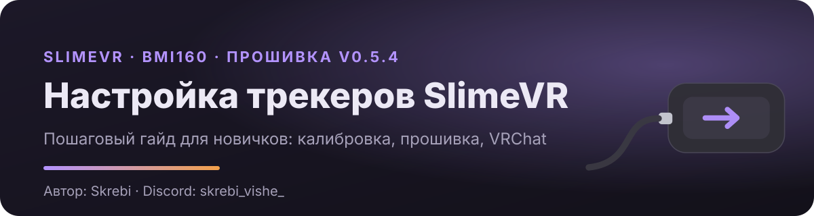

<p align="center">
  <a href="https://skrebi-vishe.github.io/Skrebi-Vishe/Slime-VR-setup/"></a>
</p>

<p align="center">
  <a href="https://skrebi-vishe.github.io/Skrebi-Vishe/Slime-VR-setup/"></a>
  &nbsp;
  
</p>

# Привет, я Skrebi

Собираю и настраиваю трекеры для полного отслеживания тела в VR (**SlimeVR**) и помогаю другим сделать то же самое. Здесь лежит мой гайд, по которому можно с нуля откалибровать старые DIY‑трекеры и получить точный трекинг.

## Гайд «Настройка трекеров SlimeVR с нуля»

**[→ Открыть гайд](https://skrebi-vishe.github.io/Skrebi-Vishe/Slime-VR-setup/)** · работает в браузере на компьютере и телефоне.

**Для кого:** трекеры SlimeVR первого поколения на плате **Wemos D1 Mini (ESP8266)** с датчиком **BMI160**. Только у BMI160 есть температурная калибровка, ради которой и написан гайд.

**Что внутри, по шагам:**

| | Шаг | Время |
|:-:|---|:-:|
| 1 | Проверка, подходят ли трекеры | 2 мин |
| 2 | Подготовка: калибровочная коробочка, упор, программы | 10 мин |
| 3 | Прошивка v0.5.4 через сайт, поворот датчика, сброс старых данных | 5 мин на трекер |
| 4 | Калибровка по осям (6 сторон), с подсказками по консоли | 5 мин |
| 5 | Температурная калибровка с холодильником и феном | от 35 мин |
| 6 | Проверка калибровки на TCAL Checker | 2 мин |
| 7 | Пол в шлеме и SteamVR | 5 мин |
| 8 | Как правильно надеть трекеры | 5 мин |
| 9 | Настройка в SlimeVR | 10 мин |
| 10 | Калибровка в VRChat | 2 мин |

А ещё: порядок действий перед каждой игрой, частые проблемы и их решения, 3D‑схемы калибровки и модели корпусов Hyperion для 3D‑печати (комплект 8+2).

## Что в репозитории

```
docs/Slime-VR-setup/   — гайд: index.html, css/, js/, img/, models/ и свой README
.github/               — оформление этой страницы
```

## Связь

Вопросы, идеи и найденные ошибки пишите в Discord: **skrebi_vishe_**

<sub>Гайд составлен сообществом и не является официальным документом SlimeVR.</sub>
